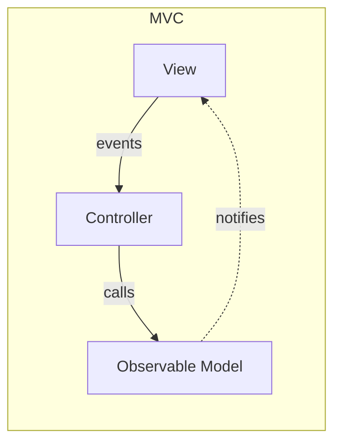
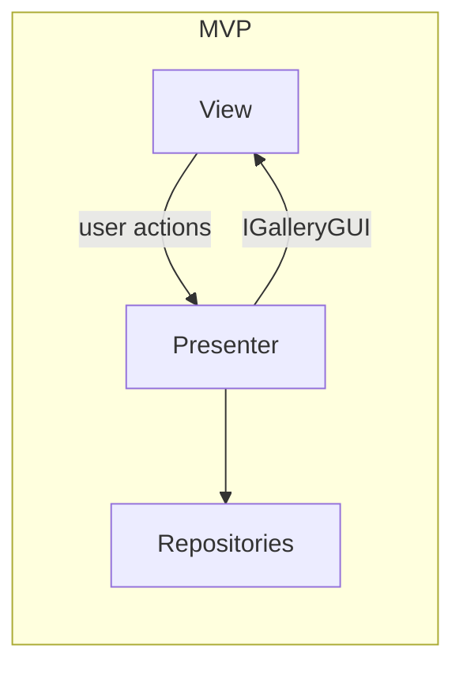
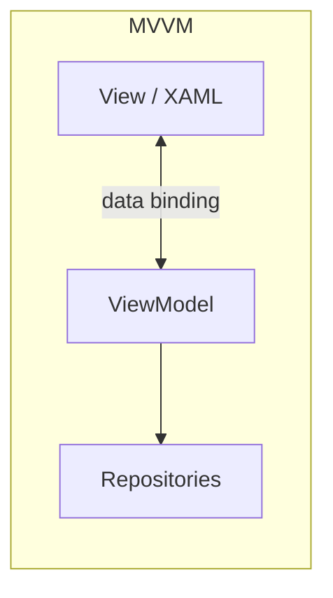
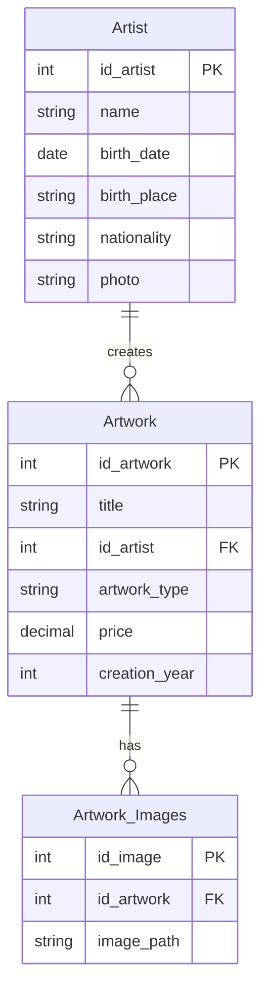
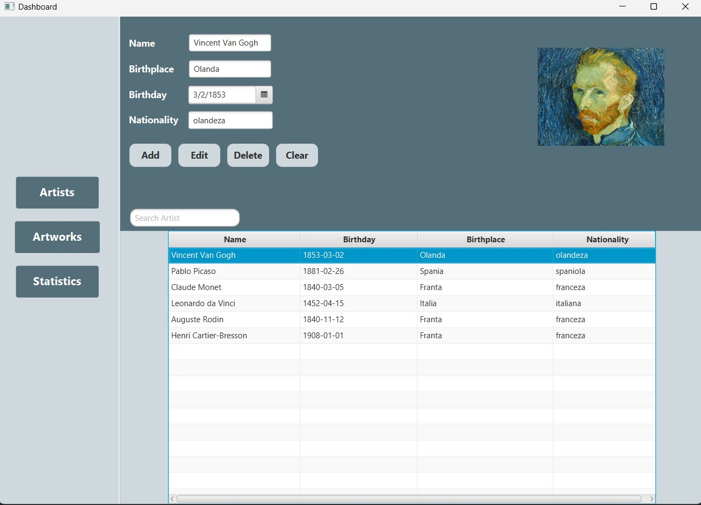
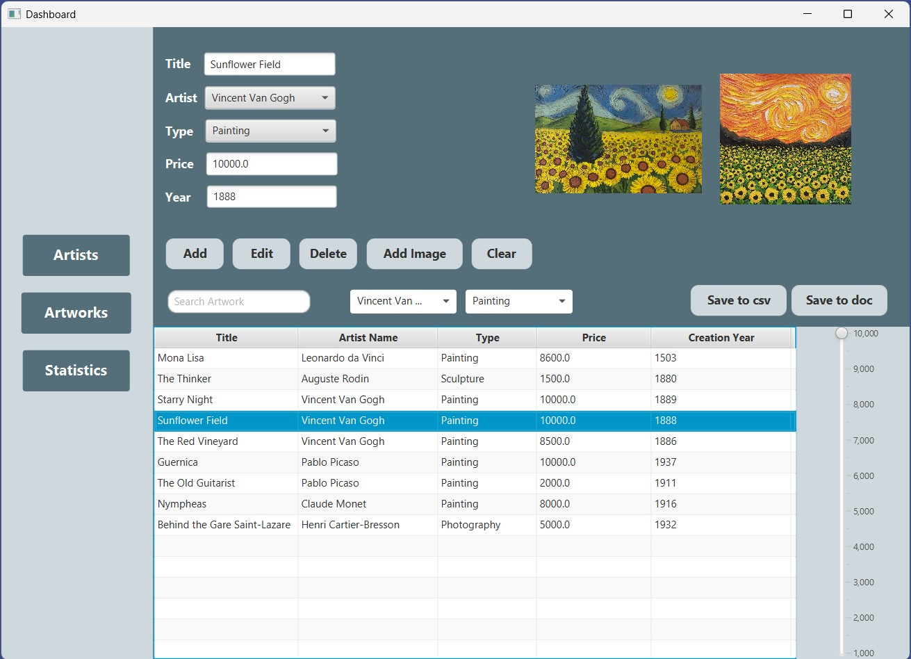
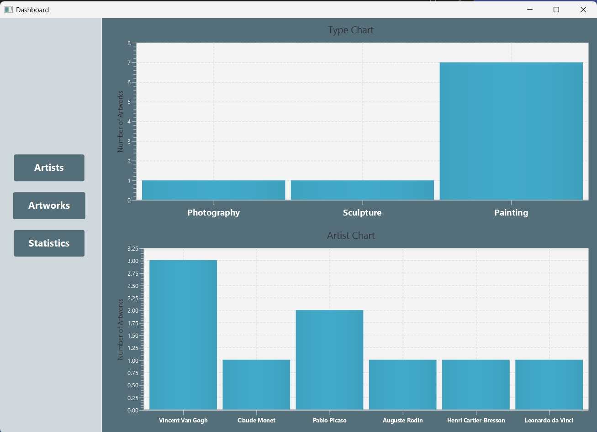

# Art Gallery: MVC vs MVP vs MVVM

The same desktop application, implemented three times with three different UI architectural patterns. Built for the *Software Design* course at university.

| Project | Pattern | Stack | Database |
|---|---|---|---|
| [`mvc-javafx`](mvc-javafx) | MVC (with Observer) | Java 21, JavaFX, Maven | SQLite |
| [`mvp-javafx`](mvp-javafx) | MVP (passive view) | Java 21, JavaFX, Maven | SQLite |
| [`mvvm-wpf`](mvvm-wpf) | MVVM | C#, .NET 8, WPF | SQL Server LocalDB |

## The application

An art gallery manager for artists and their artworks.

- CRUD operations for artists and artworks
- Artist photo and up to two images per artwork
- Search by name / title
- Filter artworks by artist, type and maximum price
- Export the artwork list to CSV and TXT
- Statistics charts (artworks per type and per artist), **MVC version only**

## Architecture comparison

| | MVC | MVP | MVVM |
|---|---|---|---|
| View talks to | Controller | Presenter, through the `IGalleryGUI` interface | ViewModel, through data binding |
| Update flow | Model notifies the View (Observer) | Presenter pushes data into the View | Binding reacts to `INotifyPropertyChanged` |
| View knows about logic | Exposes its controls to the Controller | No, the View is passive | No, only XAML bindings |
| Main classes | `GalleryView`, `GalleryController`, `GalleryViewModel` | `GalleryGUI`, `IGalleryGUI`, `GalleryPresenter` | `GalleryGUI.xaml`, `GalleryViewModel`, `GalleryCommand` |







> Note: in the MVC project, `GalleryViewModel` (package `Model.ViewModel`) is an observable model that the view subscribes to. It is not a ViewModel in the MVVM sense.

## Running the projects

### MVC and MVP (Linux, macOS, Windows)

Requirements: **JDK 21**. Maven is not needed, the included Maven Wrapper downloads it.

```bash
cd mvc-javafx        # or mvp-javafx
./mvnw clean javafx:run      # on Windows: mvnw.cmd clean javafx:run
```

The SQLite file `database.sqlite` and its tables are created automatically on first start, in the directory you run the command from.

### MVVM (Windows only)

Requirements: Windows, .NET 8 SDK, SQL Server LocalDB (installed with Visual Studio), Visual Studio 2022 recommended.

1. Create a database named `art_gallery`.
2. Run [`database/schema-sqlserver.sql`](database/schema-sqlserver.sql) on it.
3. Open `mvvm-wpf/AssignmentMVVM.sln` and run the project.

Selected images are copied to an `Images` folder next to the executable.

> WPF does not run on Linux. The MVVM project was compiled successfully, but it was last run on Windows before the final cleanup.

## Database



Schemas: [`database/schema-sqlite.sql`](database/schema-sqlite.sql) (Java projects) and [`database/schema-sqlserver.sql`](database/schema-sqlserver.sql) (C# project).

## Screenshots and diagrams

The [`docs`](docs) folder contains:

- [`ui`](docs/ui): application screenshots
- [`class`](docs/class): class and package diagrams
- [`sequence`](docs/sequence): sequence diagrams for each operation
- [`activity`](docs/activity): activity diagrams





## Repository structure

```
.
├── mvc-javafx/    # MVC implementation
├── mvp-javafx/    # MVP implementation
├── mvvm-wpf/      # MVVM implementation
├── database/      # SQL schemas
└── docs/          # diagrams and screenshots
```

## Known limitations

- MVP: data travels between presenter and view as comma-separated strings, so a comma inside a name or title breaks the table display.
- MVVM: export saves the list currently displayed (filtered or not), not the full collection.
- No automated tests; the goal of the project is the comparison of architectures.